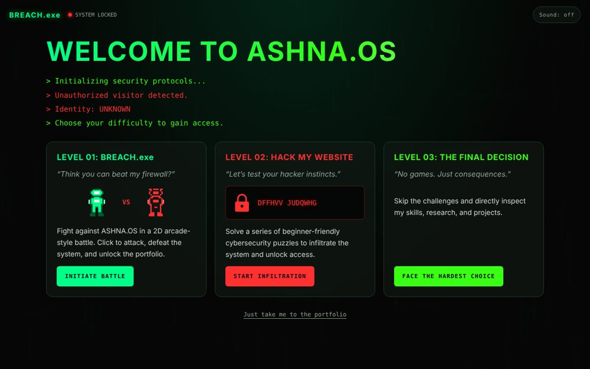
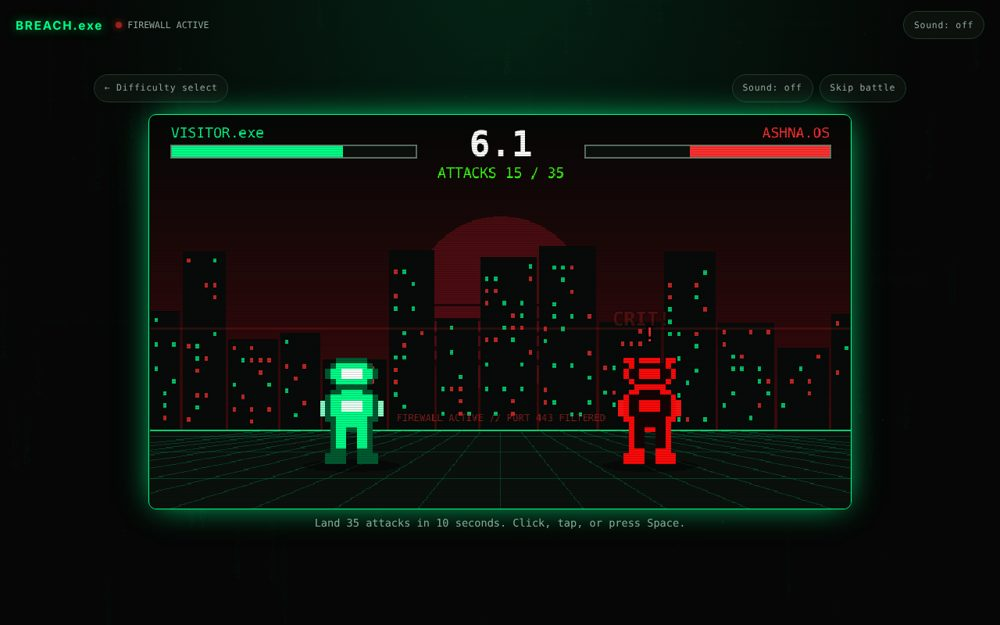
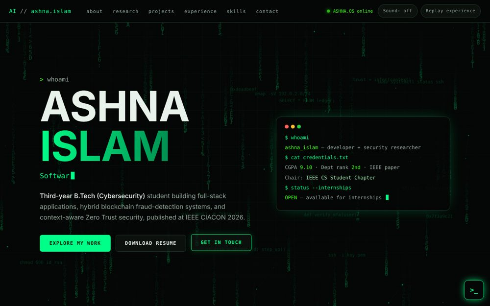

<div align="center">

# BREACH.exe

### An interactive cybersecurity portfolio by **Ashna Islam**

*You can beat my firewall. But can you make the hardest decision and hire me?*

**[▶ Play it live](https://ashna-grey.github.io/breach_portfolio/)**  ·  [Resume (PDF)](assets/Ashna_Islam_Resume.pdf)  ·  [LinkedIn](https://www.linkedin.com/in/ashna-islam/)  ·  [Email](mailto:ashnaislam03@gmail.com)



</div>

---

## 30-second summary

I'm a **3rd-year B.Tech CSE (Cybersecurity)** student at IEM Kolkata, looking for a **cybersecurity or ML internship**.

- **Published research:** Bayesian Zero Trust access control, IEEE DOI [10.1109/CIACON70148.2026.11688234](https://doi.org/10.1109/CIACON70148.2026.11688234)
- **Academics:** CGPA 9.10 (up to 4th semester), **2nd rank in department** (2025–2026)
- **Experience:** Cybersecurity Intern at WBEIDC; Research Project Intern at IEDC Lab, IEM Kolkata
- **Leadership:** Chair, IEEE Computer Society Student Branch Chapter (15 technical events, 100+ members); President, Google Gemini Student Community

This repository is the site you see when you open my portfolio: the portfolio itself, plus a small game around the front door, because I like building things.

---

## Three ways in

The site opens as a locked system, **ASHNA.OS**. Pick a difficulty. Every path leads to the same portfolio, and nothing is ever blocked.

| Level | What it is | Time |
|---|---|---|
| **01: BREACH.exe** | A 2D pixel-art fighting game built with **Phaser 3**. Land 35 attacks in 10 seconds while ASHNA.OS hits back. Lose, and you can still enter. | ~15 s |
| **02: Hack My Website** | Three beginner security puzzles in a fake terminal: a Caesar cipher, spotting a brute-force login, finding an authentication flaw. Hints and explanations included. | ~2 min |
| **03: The Final Decision** | Skip everything and go straight to the portfolio. | 2 s |

*Short on time? Choose Level 03, or click "Just take me to the portfolio."*



---

## Inside the portfolio

- **Research files:** publications as expandable dossiers, with the DOI for the published paper
- **Projects:** Zero-Trust access control, ML-based network anomaly detection, Crop Sage, Ethereum wallet fraud detection, noise-aware quantum teleportation with reinforcement learning
- **Experience & leadership timeline:** internships, study abroad in Thailand, IEEE, Google Gemini community, Toastmasters
- **Skills dashboard:** hover or tap any skill to see where I actually used it (no made-up percentage bars)
- **Recognition & certifications:** including IIT Kharagpur, University of Colorado and SkillUp courses
- **Hidden terminal:** click the `>_` button and type `help`. Try `sudo hire ashna`.



---

## Engineering notes

This is also a sample of how I build.

| Decision | Why |
|---|---|
| **No backend, no build step** | Plain HTML, CSS and JavaScript on GitHub Pages. Nothing to break, nothing to patch. |
| **Phaser loads only for Level 01** | The 1.2 MB game engine is never downloaded by recruiters who choose Level 03. |
| **Real-time game clock** | The 10-second round uses real elapsed time, not frame counts, so slow devices play fair. |
| **Input guards** | Held keys are ignored and inputs closer than 45 ms apart are dropped, so macros can't win. |
| **Safe terminal** | The terminal matches input against a fixed command list. It never evaluates user input, and output is written as text, never HTML. |
| **Fictional challenges** | The "hacking" puzzles are client-side and self-contained. Nothing scans, attacks or contacts any real system. |
| **Accessible by default** | Keyboard navigation, focus states, `prefers-reduced-motion` support, skip buttons everywhere, and a crawlable portfolio for people without JavaScript. |
| **Original assets** | Sprites are generated from pixel grids in code and sound is synthesized with the Web Audio API. No copyrighted characters. |

**Stack:** HTML5 · CSS3 · JavaScript · Phaser 3 · Web Audio API · sessionStorage

---

## Run it locally

```bash
git clone https://github.com/Ashna-Grey/breach_portfolio.git
cd breach_portfolio
python3 -m http.server 8000
```

Then open <http://localhost:8000>. Serve the folder instead of double-clicking `index.html`, so it behaves like GitHub Pages. To replay the intro, use **Replay experience** in the nav bar.

<details>
<summary>Project structure</summary>

```
index.html              landing gate + the whole portfolio (real, crawlable HTML)
css/                    base, gate/game/puzzle styles, portfolio styles
js/main.js              gate logic, session state, portfolio interactions
js/game.js              Phaser fighting game (lazy-loaded)
js/puzzles.js           Medium-mode challenges (lazy-loaded)
js/terminal.js          fixed-command terminal (lazy-loaded)
js/sprites.js           generated pixel-art fighters
js/audio.js             Web Audio sound effects (muted by default)
js/vendor/              Phaser 3.90.0
assets/                 resume PDF, favicon
docs/                   screenshots
```
</details>

---

## Credits & licenses

- [Phaser 3](https://phaser.io), MIT license
- Fonts: Chakra Petch, DM Sans, Share Tech Mono (SIL Open Font License, via Google Fonts)
- All sprites, sounds and visuals are original

---

<div align="center">

**Let's talk.**  [ashnaislam03@gmail.com](mailto:ashnaislam03@gmail.com)  ·  [LinkedIn](https://www.linkedin.com/in/ashna-islam/)  ·  [GitHub](https://github.com/Ashna-Grey)

*Kolkata, India*

</div>
